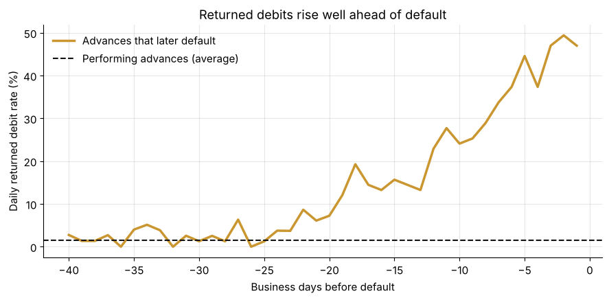
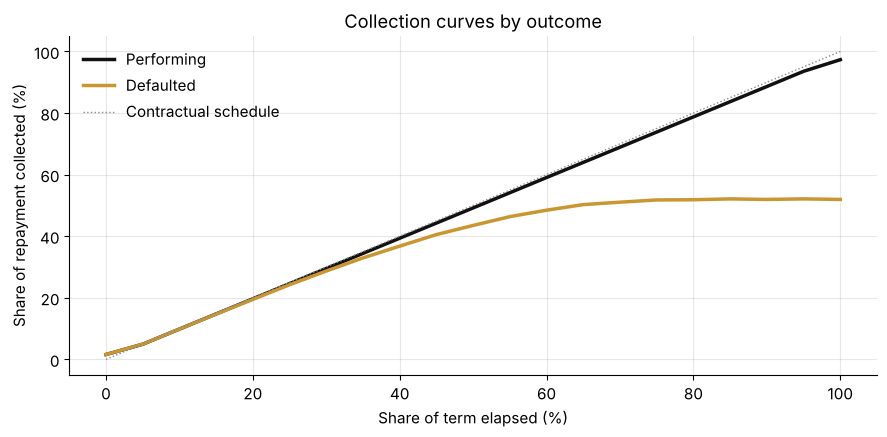

# Daily Remittance Signals in Revenue-Based Finance

A synthetic study of how early, and how reliably, daily remittance behavior signals an eventual default in small-business revenue-based finance.



## Method

The notebook simulates 500 advances with funded amounts, factor rates, and terms typical of the asset class. Each merchant carries a latent risk score that drives both a baseline rate of returned debits and the probability of default. Merchants that default show rising returns over the 30 business days before payments stop.

The analysis then measures:

1. The daily returned debit rate ahead of default, against the performing baseline
2. Collection curves for performing and defaulted advances, normalized by term
3. Discrimination (AUC) of trailing return counts over 5 to 30 day windows
4. Precision and recall of simple watch-list thresholds

## Findings

- Returned debits depart from the performing baseline of about 1.5% roughly three weeks before default and approach 50% in the final days.
- A trailing 10-day count of returned debits reaches an AUC of about 0.75 for default within 30 days. Longer windows add nothing.
- Three returns within 15 business days is correct nearly nine times in ten, which makes it a practical servicing trigger.
- Collection curves for defaulted advances fall below schedule well before the default date.



## Contents

| Path | Description |
| --- | --- |
| `daily-remittance-signals.ipynb` | Executed notebook with code, tables, and charts |
| `*.png` | Charts exported from the notebook |

## Reproduce

```bash
pip install numpy pandas matplotlib scikit-learn jupyter
jupyter nbconvert --to notebook --execute daily-remittance-signals.ipynb
```

The random seed is fixed, so results are deterministic.

## Author

Ali Barkhordar, Founder and Chief Executive Officer, Ultimate Business Capital LLC

- [alibarkhordar.com](https://www.alibarkhordar.com)
- [Kaggle](https://www.kaggle.com/alibarkhordarubc)
- [LinkedIn](https://www.linkedin.com/in/alibarkhordar/)

---

*This repository uses synthetic data for educational and research purposes. It does not describe any actual portfolio.*
